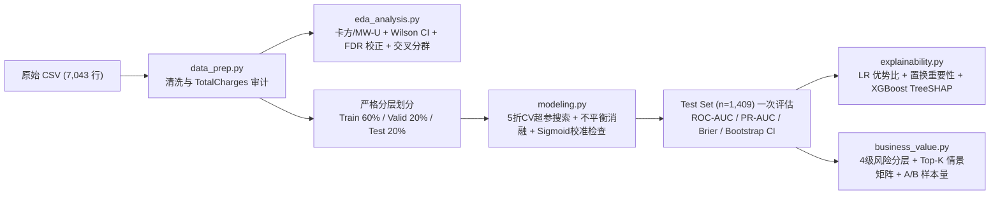
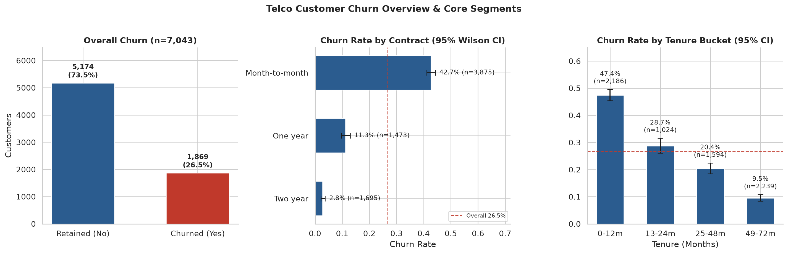
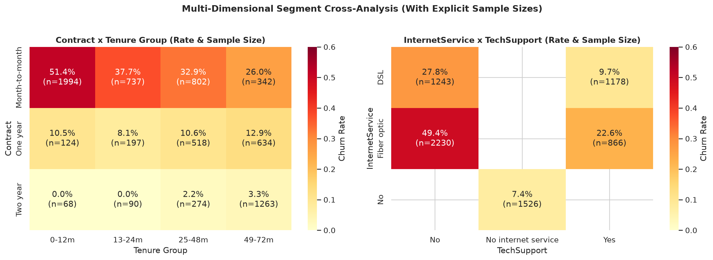
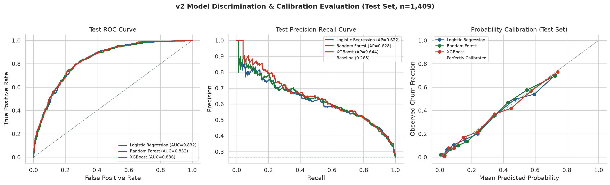
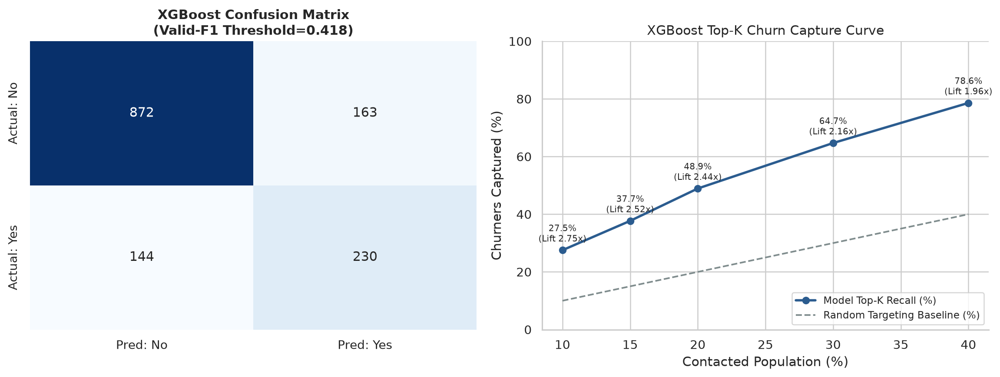
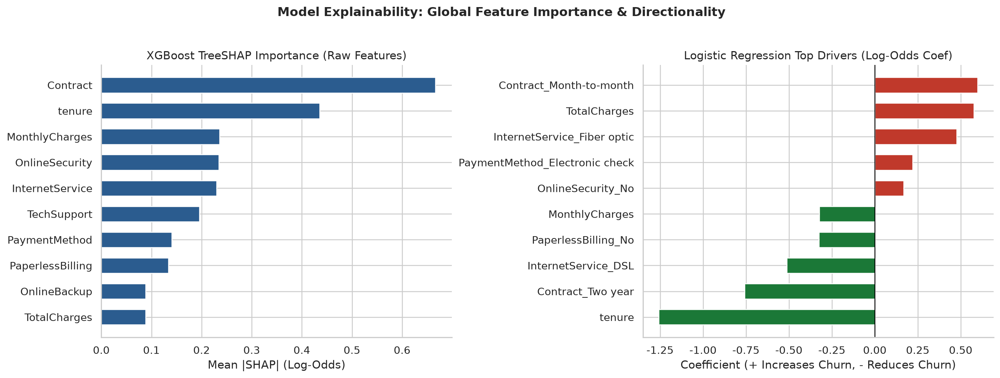
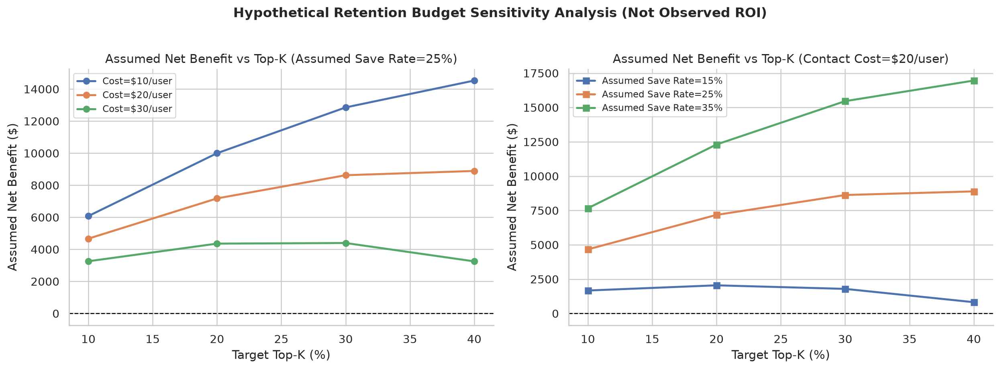

# Telco Customer Churn Analysis v2 — 电信客户流失预测与留存资源优化

[](https://github.com/12baixic-del/telco-customer-churn-analysis/actions/workflows/ci.yml)

面向**数据分析实习生、商业分析实习生与初级数据科学岗位**的端到端可复现作品集工程。  
本项目基于 IBM Telco Customer Churn 数据集（`7,043` 名客户、`21` 列），完成从**数据质量审计、统计检验与多重比较校正、防泄漏机器学习流水线（5 折 CV 调优 + 校准 + Bootstrap 不确定性）、XGBoost 原生 TreeSHAP 可解释性**到**风险分层、Top-K 触达预算情景模拟与 A/B 测试实验设计**的完整闭环。

---

## 1. 项目背景与业务目标

在订阅制电信业务中，获客成本显著高于存量维护成本。围绕“**谁最可能流失、为什么流失、在有限触达预算下优先挽留谁**”三个核心问题，本项目实现：
1. **统计驱动分群定位**：识别具有统计显著性（FDR 校正后 $q < 0.05$）与高效应量（Cramér's $V$）的高流失风险客群，同时标出样本量与 Wilson 95% 置信区间，避免小样本误导。
2. **严谨机器学习建模**：在 `60% / 20% / 20%` 严格隔离下，使用 `ColumnTransformer` + `Pipeline` 优化 **Logistic Regression、Random Forest、XGBoost**（附 `Dummy Baseline` 下界参照），对比类别不平衡处理与概率校准收益，并用 Bootstrap 评估 95% CI。
3. **业务可解释与资源分配**：结合 LR 优势比、原始特征置换重要性与 XGBoost 原生 TreeSHAP 揭示风险因子及共线性偏差；在明确假设条件下模拟 Top-K 预算敏感性与 A/B 测试样本量。

---

## 2. 数据来源与样本情况

- **数据来源**：IBM 公开示例数据集 [Telco Customer Churn](https://github.com/IBM/telco-customer-churn-on-icp4d/blob/master/data/Telco-Customer-Churn.csv)（`data/raw/Telco-Customer-Churn.csv`，SHA-256: `16320c9c1ec72448db59aa0a26a0b95401046bef5d02fd3aeb906448e3055e91`）
- **样本规模**：`7,043` 名唯一客户（`0` 行全重复、`0` 个重复 ID），总体流失 **`1,869` 人（`26.5%`，Wilson 95% CI: `[25.5%, 27.6%]`）**
- **关键数据质量发现**：`TotalCharges` 有 `11` 个空白值，经核查全部对应 `tenure == 0` 的新入网客户（且均为 `Churn = No`）。处理时保留全部 `7,043` 名客户，在训练集内拟合中位数插补。

---

## 3. 技术栈与项目结构

- **核心技术栈**：`Python 3.13`、`pandas`、`numpy`、`scipy`、`scikit-learn`、`xgboost`、`matplotlib`、`seaborn`、`unittest`、`GitHub Actions`（可选本地展示：`streamlit`）

```text
telco-customer-churn-analysis/
├── .github/workflows/ci.yml        # GitHub Actions 自动化测试门禁
├── app/streamlit_app.py            # 本地交互式展示页面（读取 reports/ 预生成产出）
├── data/
│   ├── raw/Telco-Customer-Churn.csv
│   └── processed/telco_cleaned.csv
├── notebooks/01_telco_churn.ipynb  # 保留 v1 历史探索 Notebook 完整可追溯
├── reports/
│   ├── legacy_v1/                  # 归档 v1 基线 model_comparison_v1.csv 与旧报告
│   ├── figures/                    # 6 张统一风格高清图表 (01 ~ 06)
│   ├── eda_stats_summary.json      # 统计检验、FDR 校正与交叉分群结果
│   ├── model_comparison.csv        # v2 三模型 + 基线测试集公平对比
│   ├── model_cv_summary.json       # 5 折 CV、不平衡消融、校准、Bootstrap CI 与 Top-K
│   ├── explainability_summary.json # LR 优势比、置换重要性、TreeSHAP 与典型画像/误判
│   └── business_scenarios.json     # 风险分层、Top-K 预算敏感性矩阵与 A/B 样本量
├── scripts/run_pipeline.py         # 一键端到端复现流水线
├── src/                            # 模块化源码 (config / data_prep / eda / modeling / explainability / business_value / visualization)
├── tests/test_pipeline.py          # 7 项自动化单元测试与产物一致性校验
├── BUSINESS_REPORT.md              # 面向业务经理的中文业务报告
├── MODEL_REPORT.md                 # 建模、调优、校准与选型报告
├── INTERVIEW_GUIDE.md              # 数据分析实习面试指南（3分钟介绍 + 技术/业务追问）
└── RESUME_BULLETS.md               # 可直接用于简历的证据化项目描述
```

---

## 4. 分析与建模流程



---

## 5. 主要发现与模型结果

### 5.1 核心统计与交叉分群发现（非因果关系）
- **合同类型与在网时长**：`Contract` 与流失关联最强（$\chi^2=1184.6$, Cramér's $V=0.4101$, $q<0.001$）；流失组在网中位数仅 **`10.0` 个月**，远低于留存组 **`38.0` 个月**（Mann-Whitney $U$ 检验 $q<0.001$）。
- **最高优先级交叉客群**：**`Month-to-month` × `0-12m` 新客**共 **`1,994` 人**，流失率高达 **`51.4%`**（95% CI: `[49.2%, 53.5%]`），贡献了全量 `1,869` 名流失客户中的 **`54.8%`**（`1,024` 人）。
- **光纤无技术支持客群**：`Fiber optic` × `TechSupport = No` 共 **`2,230` 人**，流失率 **`49.4%`**（95% CI: `[47.3%, 51.4%]`），占全量流失 **`58.9%`**；而同为 `Fiber optic` 但具备 `TechSupport = Yes` 的客群（`866` 人）流失率仅为 **`22.6%`**。

### 5.2 测试集模型性能对比（`n=1,409`，严格隔离）

| 模型 | v1 ROC-AUC | **v2 ROC-AUC** | v1 PR-AUC | **v2 PR-AUC** | v2 Brier Score | v2 F1 (验证集阈值) |
| :--- | :---: | :---: | :---: | :---: | :---: | :---: |
| **XGBoost (CV 调优)** | 0.786 | **0.8362** | 0.558 | **0.6442** | **0.1392** | 0.5997 |
| **Random Forest (CV 调优)** | 0.806 | **0.8323** | 0.591 | **0.6283** | 0.1407 | **0.6277** |
| **Logistic Regression (CV 调优)** | 0.832 | **0.8324** | 0.622 | **0.6221** | 0.1414 | 0.5702 |
| Dummy Baseline (Stratified) | — | 0.4981 | — | 0.2647 | 0.3925 | 0.2636 |

- **关键结论**：v1 中默认参数过拟合的 XGBoost 经浅树正则化（`max_depth=2, learning_rate=0.03, reg_lambda=5.0`）后，PR-AUC 由 `0.558` 跃升至 **`0.6442`**（+0.086），概率校准误差最低（Brier `0.1392`）。使用 XGBoost 对测试集按风险排序，触达 **Top 20%**（`282` 人）即可捕获 **`48.9%`** 的实际流失客户（精确率 `64.9%`，Lift **`2.44x`**）。

---

## 6. 可视化展示

| 整体概览与核心分群 | 多变量交叉热力图 | 模型区分度与校准曲线 |
| :---: | :---: | :---: |
|  |  |  |

| 混淆矩阵与 Top-K 捕获 | TreeSHAP 与 LR 解释 | 触达预算敏感性情景 |
| :---: | :---: | :---: |
|  |  |  |

---

## 7. 本地运行教程

```bash
git clone https://github.com/12baixic-del/telco-customer-churn-analysis.git
cd telco-customer-churn-analysis
pip install -r requirements.txt

# 1. 运行自动化单元测试（验证数据隔离与产出一致性）
python -m unittest discover -s tests -v

# 2. 一键端到端复现清洗、统计检验、CV 训练、TreeSHAP、情景分析与全部图表
python scripts/run_pipeline.py

# 3. （可选）启动本地 Streamlit 交互式展示页（需额外安装 streamlit）
pip install streamlit
streamlit run app/streamlit_app.py
```

---

## 8. 延伸文档与面试资料

- 面向业务经理的解读与留存方案：[`BUSINESS_REPORT.md`](BUSINESS_REPORT.md)
- 模型调参、校准与选型技术细节：[`MODEL_REPORT.md`](MODEL_REPORT.md)
- 数据分析实习面试准备（3 分钟自述 + 高频追问）：[`INTERVIEW_GUIDE.md`](INTERVIEW_GUIDE.md)
- 简历项目描述（带证据支撑）：[`RESUME_BULLETS.md`](RESUME_BULLETS.md)

---

## 9. 模型局限性与后续改进方向

1. **横截面数据局限**：数据无明确观察窗口、消费时间序列与客服投诉/网络质量日志，无法区分“合同到期未续约”与“主动销户”，相关性不代表因果性。
2. **缺少真实成本与干预效应**：商业情景中的单客触达成本、毛利率（60%）与挽回率（15%–35%）均为显式假设，上线前必须通过 A/B 实验实测验证。
3. **后续方向**：补充时间外验证（Out-of-Time Validation）、客户生命周期价值（LTV）加权排序，以及对低风险但突然流失客户（FN）补充外部投诉/使用量下降特征。
