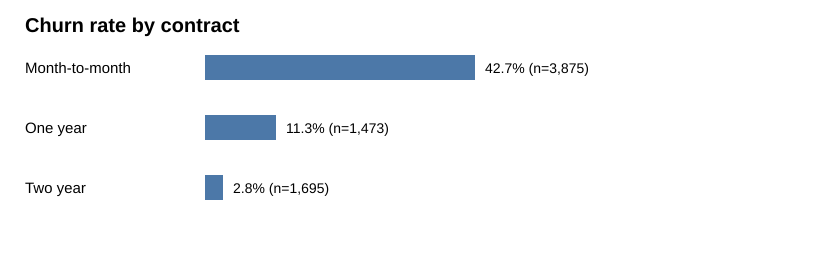
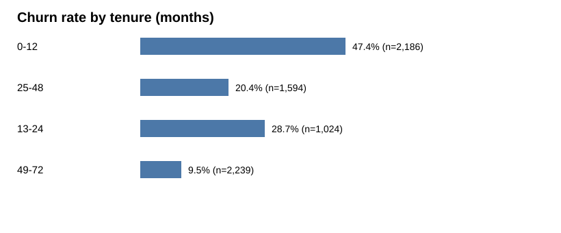
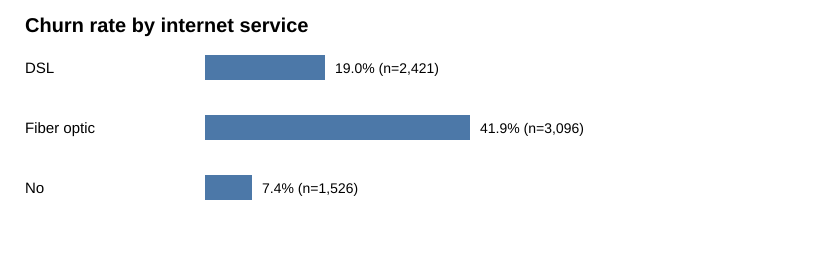
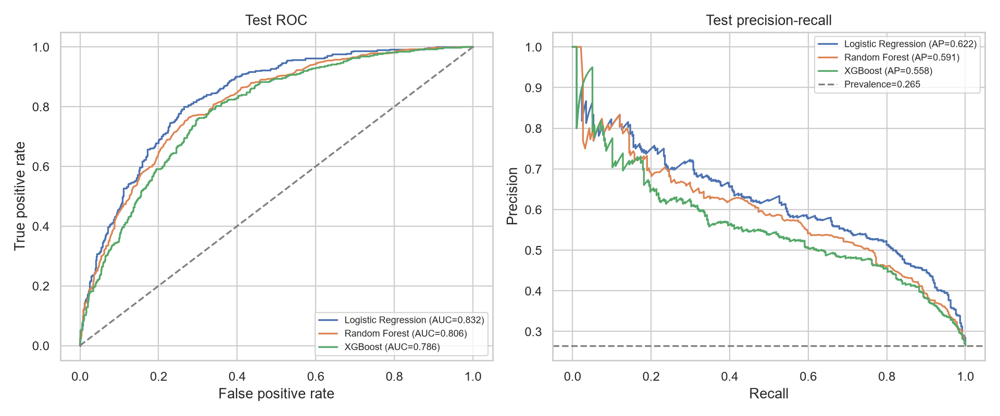

# 电信客户流失分析：第一版业务报告

## 目标与口径

识别值得优先调查的客户群，为留存实验和预测模型提供依据。样本共 7,043 位客户；流失率 = 标记为 Yes 的客户数 / 该组客户数。数据为静态样本，缺少明确观察期、流失定义、干预成本和结果。以下差异是相关性，不能证明原因。

## 已核实发现

- 整体流失 1,869 人，流失率 26.5%。
- 按合同：月付 42.7%（1,655 / 3,875）；一年合同 11.3%（166 / 1,473）；两年合同 2.8%（48 / 1,695）。月付客户人数较多且流失率较高，适合优先开展原因调查。
- 在网 0–12 个月客户流失率 47.4%（1,037 / 2,186）；49–72 个月客户 9.5%（213 / 2,239）。可重点检查新客入网和前一年体验，但不能据此断言在网时长造成差异。
- TotalCharges 有 11 个空白；清洗时保留客户并转换为缺失值，模型使用训练集拟合的中位数插补。

## 模型评估与取舍

三个模型使用相同的分层训练、验证和测试划分（60% / 20% / 20%），预处理仅在训练集拟合；各自的分类阈值在验证集按 F1 选择。下表是用户本机执行 Notebook、无报错后提供的测试集结果，测试集共 1,409 人。PR-AUC 采用 average precision；精确率、召回率和 F1 取决于各模型选择的阈值。

| 模型 | ROC-AUC | PR-AUC | 精确率 | 召回率 | F1 |
|---|---:|---:|---:|---:|---:|
| Logistic Regression | 0.832 | 0.622 | 0.614 | 0.532 | 0.570 |
| Random Forest | 0.806 | 0.591 | 0.521 | 0.698 | 0.597 |
| XGBoost | 0.786 | 0.558 | 0.484 | 0.676 | 0.564 |

- **Logistic Regression** 的 ROC-AUC、PR-AUC 和精确率最高，适合触达成本较高、资源有限，或需要较易解释的基线时优先考虑；在当前阈值下召回率为 53.2%，会漏掉较多实际流失客户。
- **Random Forest** 的召回率和 F1 最高，当前阈值下识别出 69.8% 的实际流失客户；精确率为 52.1%，意味着预计需要处理更多误报。若漏掉流失客户的代价较高，可作为留存试验的候选。
- **XGBoost** 在本次默认参数和选定阈值下的排序指标、精确率、召回率与 F1 均低于 Random Forest；本次没有充分调参，不代表该算法在其他设置下必然较差。

这些阈值是为验证集 F1 选择的演示方案，不能直接认为适合特定触达预算。测试集结果用于评估，不应继续用它挑选业务阈值。

## 业务建议及验证

1. 优先调查月付与新客的重叠群体，结合投诉、服务质量和竞争信息查找可干预问题；上述分组重叠，不能将两者的影响相加。
2. 先明确触达容量、每次触达成本、客户价值和漏报成本，在验证集比较不同阈值的精确率、召回率及预计触达量：资源紧张时可从 Logistic Regression 开始评估，侧重覆盖时可从 Random Forest 开始评估。最终选择需结合业务成本，不能只按 F1 决定。
3. 对模型圈选的客户开展随机对照试验，记录触达成本和增量留存效果。高风险不等于客户一定能被挽回；缺少干预效果和成本数据，当前无法估算投资回报。

## 局限与后续工作

以上指标来自一次随机划分，可能受抽样影响；数据缺少明确预测时点、观察窗口和成本信息。正式应用前需核实预测时可获得的字段，进行时间外验证、稳定性及公平性检查，并根据业务反馈重新选择阈值。
